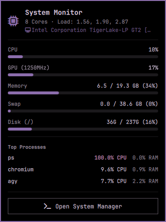

# System Monitor for Omarchy

Real-time CPU, GPU, memory, and disk monitoring status bar widget and popup panel for the Omarchy shell.



## Features

- Real-time CPU, GPU (Intel, AMD, NVIDIA), RAM, Swap, and root filesystem usage gauges
- Native GPU telemetry: Intel RC6 residency & clock frequency, AMD DRM sysfs, and NVIDIA SMI
- Top CPU-consuming processes live view
- Dynamic system manager launcher: automatically launches `btop`, `htop`, `bottom` (`btm`), or `top` based on what is available
- Clean status bar icon matching Omarchy bar styling
- Right-click status bar toggle for inline percentage

## Installation

```bash
omarchy plugin add https://github.com/codesdilkhush/omarchy-sysmon --enable
```

## Removal

```bash
omarchy plugin remove codesdilkhush.sysmon
```
